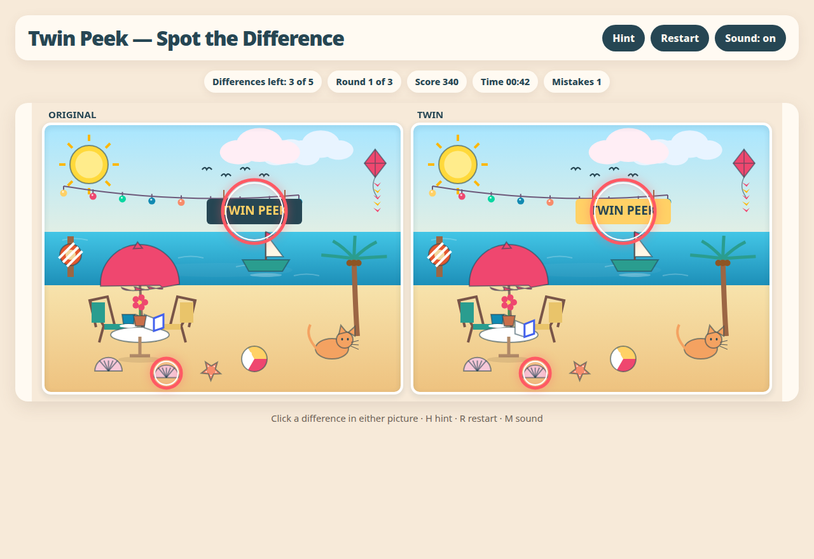

# Twin Peek — Spot the Difference

  

## The game

Two near-identical seaside café scenes are drawn procedurally on a canvas. Click the differences in either picture. Play three rounds with 5, 7, and 9 differences; the last round is subtler. Wrong clicks add 3 seconds, hints cost points, and WebAudio provides sound effects. Use the keyboard shortcuts H/R/M/N.

## How it works

The scene is a data spec of placed items in `game/src/scenes.js`. The twin is made by mutating that spec in `game/src/differences.js`, so every difference is exact and clickable at a known anchor. Rendering uses plain Canvas 2D in `game/src/render.js`. There are no libraries or network requests; everything under `game/` is a static file.

## Run it

Serve `game/` with any static file server and open `index.html`. For hand-in, run `MAKEFUN_OUTPUT_DIR=out node main.ts`; it copies `game/` and `screenshots/` out and writes the dossier.

Built for make.fun's [Make the best spot the difference game](https://make.fun/bounty/best-spot-the-difference-game-20261121-0451) bounty.
